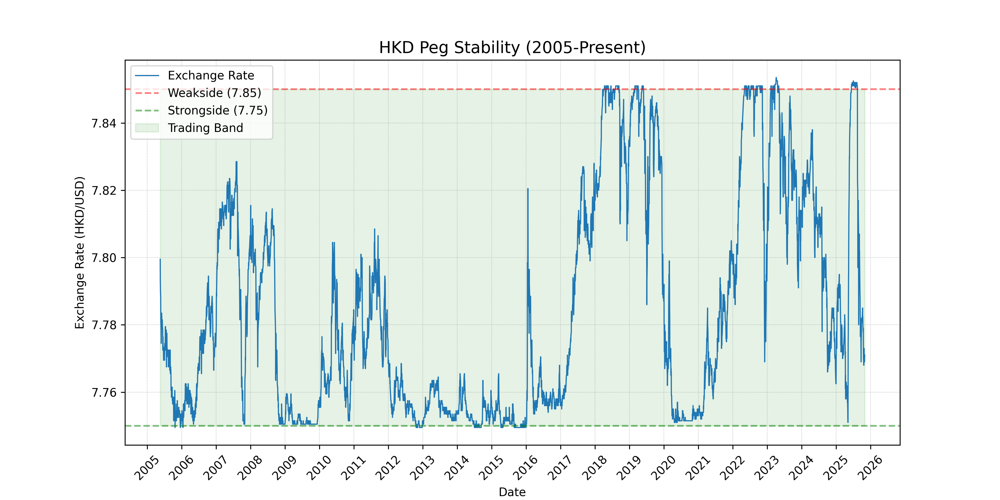
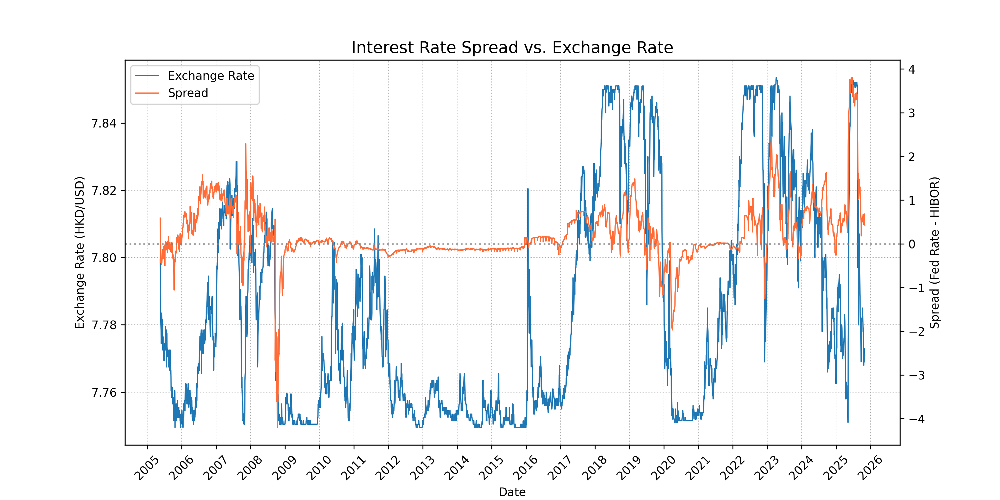
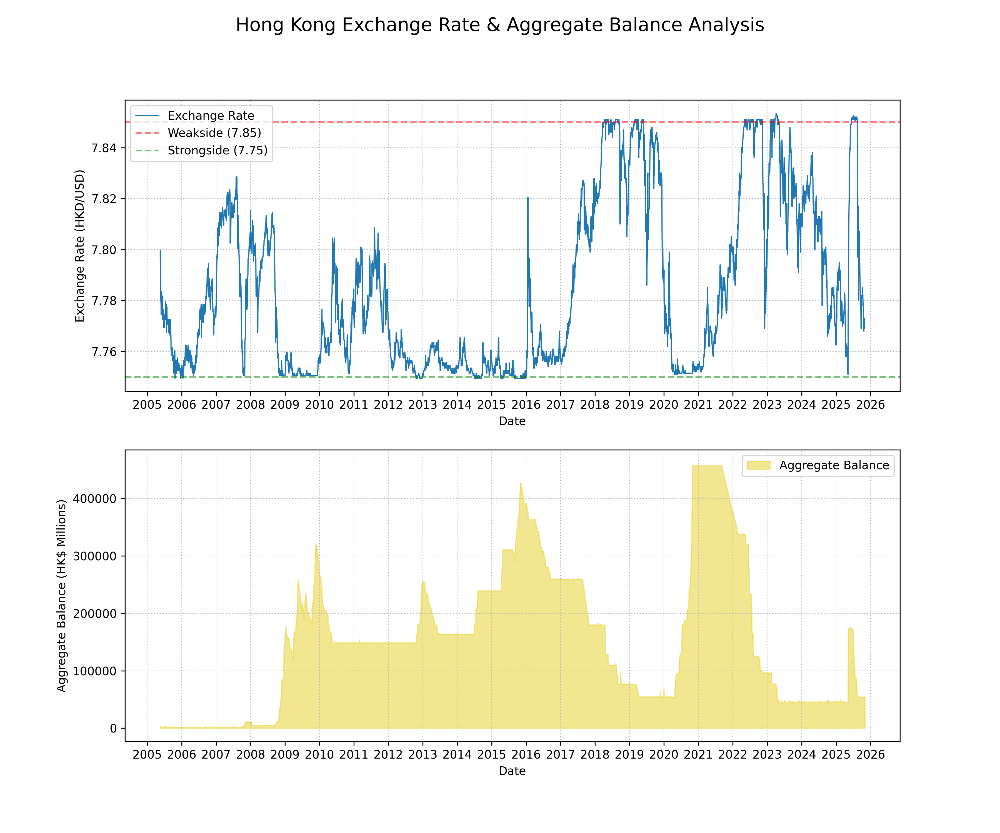
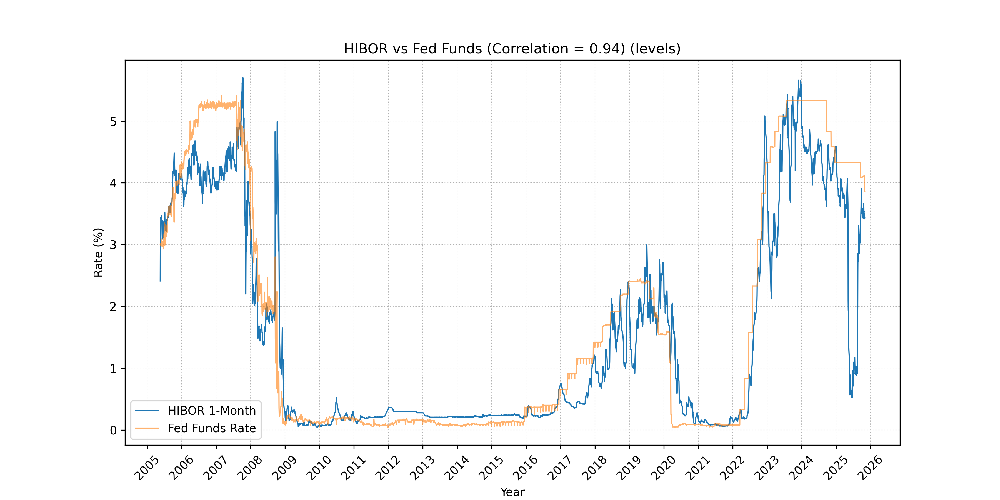

# Hong Kong Dollar Peg Analysis (2005-2025)

**Quantifying the resilience of the Linked Exchange Rate System (LERS) through 20 years including financial crises.**

## Executive Summary
This project analyzes the HKD/USD peg from **May 2005 to Present**, focusing on the "Convertibility Undertaking" (7.75 - 7.85 band). Using Python (Pandas/Matplotlib), I modeled the interaction between **Interest Rate Spreads**, **Capital Flows**, and **HKMA Intervention** over a dataset of 5,000+ trading days.

---

## 🔎 Statistical Analysis & Key Findings

### 1. Peg Stability Metrics (2005-2025)
* **Band Adherence:** The spot rate remained within the 7.75-7.85 band for **93.18%** of all trading days.
* **Technical Breaches:** Recorded 203 days above 7.85 (3.98%) and 145 days below 7.75 (2.84%).
* **Low Volatility:** Annualized volatility was **0.60%**, remarkably low compared to major floating currencies.
* **Precision:** The average deviation was only **0.033 HKD** from the peg center (7.80).

### 2. Monetary Policy Linkage
* **Policy Mirror:** A **0.94 correlation** between HIBOR and the Federal Funds Rate confirms that Hong Kong essentially imports US monetary policy.
* **Spread Influence:** The interest rate spread shows a moderate positive correlation (**0.53**) with exchange rate movements.
* **Inverse Balance Relationship:** The Aggregate Balance is inversely correlated (**-0.71**) with Fed rates, confirming that the HKMA drains liquidity when US rates rise.

### 3. HKMA Intervention Scale
* **Liquidity Growth:** The Monetary Base expanded **14.1x** (1,309%) over the 20-year period.
* **Significant Activity:** Significant interventions (>$1 Billion HKD) occurred on **545 days** (10.7% of all days), averaging ~27 days per year.
* **Extreme Defenses:**
    * **Largest Drain:** -$29.6 Billion HKD (July 7, 2025).
    * **Largest Injection:** +$116.7 Billion HKD (May 7, 2025).

### 4. Crisis Resilience Stress Test
* **2008 Financial Crisis:** Peg held perfectly (**0 Breaches**), Volatility 0.55%.
* **2020 COVID Pandemic:** Peg held perfectly (**0 Breaches**), Volatility 0.85%.
* **2019 HK Protests:** Recorded **16 Breach Days** with a +48% volatility spike.
* **2022 Fed Rate Hikes:** Recorded **12 Breach Days** during aggressive tightening.
* *Insight:* Political instability (2019) caused more technical band breaches than global financial crashes (2008/2020).

---

## Key Visualizations

### 1. Historical Exchange Rate Band Adherence
*Visualizes the spot rate relative to the 7.75-7.85 Convertibility Undertaking. While the rate stayed within bounds for 93% of the period, the chart highlights distinct periods of pressure where the rate approached the weak-side limit (7.85) for extended durations.*


### 2. Interest Rate Spread Analysis
*Illustrates the relationship between the US-HK interest rate spread and exchange rate movements r=0.53$. While the correlation is not visually noticeable, a positive spread (US rates exceeding HK rates) creates capital outflow pressure, pushing the spot rate toward the 7.85 weak-side limit, while negative spreads tend to strengthen the currency*


### 3. Aggregate Balance & Intervention Analysis
*When the rate goes toward the strong side (7.75), liquidity surges as the HKMA sells HKD (to buy USD) which can be seen around 2009-2010 and 2020-2021 with balances exceeding HK$400 billion. Conversely, liquidity drains during weak-side defense (2022-2024).*


### 4. Interest Rate Transmission Mechanism
*The 0.94 correlation is visually evident as HIBOR (blue) tracks Federal Funds Rate (orange) almost perfectly throughout the entire period. This tight relationship validates the linked exchange rate system's effectiveness in transmitting US monetary policy to Hong Kong.*


---

## Methodology

### Data Preparation
1. Fetched historical data from HKMA API (2005-present)
2. Merged exchange rates, liquidity, and federal funds data by date
3. Applied forward-fill for missing Saturday HIBOR values
4. Validated data quality through outlier detection (3σ threshold)
5. Corrected data anomaly: September 19, 2019 HIBOR (199.286% → 1.98%)
6. Filtered data to May 18, 2005 onwards (introduction of current band)


### Feature Engineering
- **Spread**: Federal Funds Rate - HIBOR (interest rate differential)
- **Flow**: Daily change in aggregate balance (intervention proxy)
- **USD Change**: Daily percentage change in exchange rate
- **Volatility**: 30-day rolling standard deviation of exchange rate changes

###Data Sources:
* **HKMA Open API:** Daily Exchange Rates, HIBOR, Aggregate Balance.
* **Federal Reserve (FRED):** Effective Federal Funds Rate.

---

## 🛠️ Technologies Used
- **Python 3.10** - Core language
- **pandas** - Data manipulation and analysis
- **matplotlib** - Data visualization
- **numpy** - Statistical calculations

---

## How to Run

1.  **Clone the repository**
    ```bash
    git clone [https://github.com/RianMehta21/hkd-peg-analysis.git](https://github.com/RianMehta21/hkd-peg-analysis.git)
    cd hkd-peg-analysis
    ```

2.  **Install dependencies**
    ```bash
    pip install -r requirements.txt
    ```

3.  **Run data collection scripts**
    To fetch the latest raw data from the HKMA API:
    ```bash
    python get_exchange_rates.py
    python get_liquidity.py
    ```

4.  **Run the analysis**
    * **Data Prep:** Run `data_prep.ipynb` to process raw data into `data/master.csv`.
    * **Analysis:** Run `analysis.ipynb` to generate charts and statistics.
---

## 📂 Project Structure
```text
HKD_Peg_Analysis/
│
├── data/                   # Raw CSVs and processed master dataset
├── images/                 # Saved visualization output
├── data_prep.ipynb         # ETL and Data Cleaning pipeline
├── analysis.ipynb          # Statistical analysis and plotting
├── get_exchange_rates.py   # Utility script for HKMA API
├── get_liquidity.py        # Utility script for HKMA API
├── requirements.txt        # Python dependencies
└── README.md               # Project documentation